# EagleEyes – User Manual
**Version:** UM_001 · **Team Name:** EagleEyes · **Date:** 10/11/2026

## 1. Introduction
EagleEyes Parking is a mobile and web app that helps University of North Texas (UNT) students, faculty, staff, and visitors find open parking on campus. It shows a live, color-coded map of campus lots, filters lots by parking permit, and opens your phone's maps app for directions. Users can also report parking hazards and send notes to UNT Transportation Services. Administrators use the same app to review reports, post alerts, and schedule campus events.

## 2. System Requirements
- **Device:** an iPhone or Android phone, or a computer with a current version of Chrome, Safari, Edge, or Firefox
- **Connection:** an active internet connection (Wi-Fi or cellular data)
- **Location services:** needed to show your location and nearby lots
- **Account:** a UNT email address
- **Mobile install only:** a USB cable and a computer (a Mac with Xcode for iPhone)
- **Parking data:** occupancy comes from ParkZen. If that service is unavailable, lots appear grey.

## 3. Installation Guide
**Web:** no installation required. Open **[eagle-eyes-park-production.up.railway.app](https://eagle-eyes-park-production.up.railway.app/login)** in your browser.

**Mobile:** the app is not on the App Store or Google Play. A member of the EagleEyes team installs it from a computer by cable.
- **Android:** tap **Settings → About phone → Build number** 7 times, turn on **Settings → Developer options → USB debugging**, connect the phone, and tap **Allow**. The team then runs `npx expo run:android --device` in the `frontend` folder (or `adb install EagleEyes.apk`).
- **iPhone:** connect the phone to a Mac and tap **Trust This Computer**. Turn on **Settings → Privacy & Security → Developer Mode** and restart. The team then runs `npx expo run:ios --device` in the `frontend` folder. If the app won't open, go to **Settings → General → VPN & Device Management** and trust the developer profile.

> **Note:** An iPhone install made with a free Apple developer account expires after 7 days. A paid account lasts one year.

## 4. Getting Started
1. Open EagleEyes (tap the app icon, or open **[eagle-eyes-park-production.up.railway.app](https://eagle-eyes-park-production.up.railway.app/login)** on a computer).
2. New users: tap **Sign Up**, enter your **UNT Email**, **Password**, and **Confirm Password**, then tap **Sign Up**.
3. Enter your UNT Email and Password and tap **Log In**. Forgot your password? Tap **Forgot password?** and use the code emailed to you (valid for 15 minutes).
4. When asked, allow location access (**Allow While Using App**).
5. (Optional) Add your permit. See Feature 10.

Commuters see three tabs on the bottom bar: **MAP**, **LOTS**, and **PROFILE**. The bell icon in the top bar opens **Alerts**.

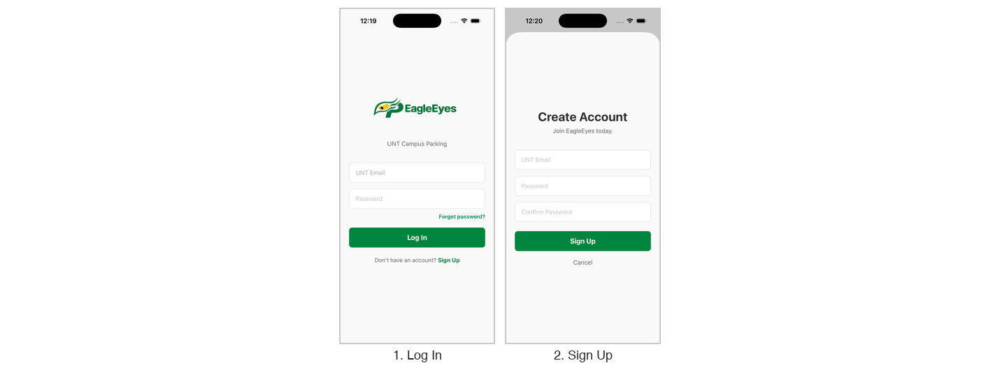

## 5. Features & Functions

### Commuter Features

#### Feature 1: Interactive Parking Map
Shows every campus lot on one map, colored by current occupancy.
1. Open the **MAP** tab.
2. Choose a campus from the **CAMPUS** dropdown (**Main campus**, **Discovery Park**, or **Frisco Landing**).
3. Drag or pinch to move and zoom, or use the **+** / **–** buttons.
4. Tap a lot to open its details sheet (see Feature 4).

**Expected result:** the map shows lot locations and their occupancy colors when parking data is available.

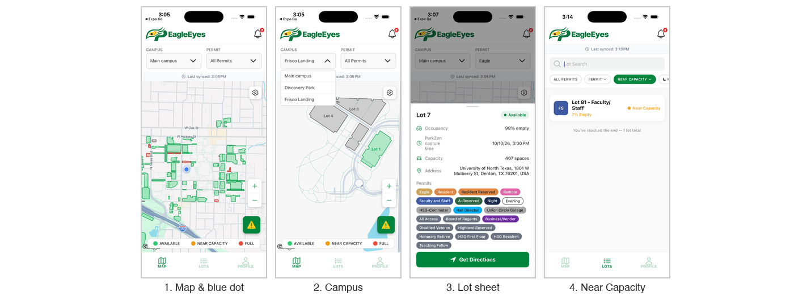

#### Feature 2: Parking Availability Indicator
Each lot is colored by how full it is. A legend is shown at the bottom of the map.

| Color | Meaning | Recommended Action |
|---|---|---|
| Green | Less than 85% full | Consider this lot |
| Orange | 85% to under 95% full | Parking is limited. Consider another lot |
| Red | 95% to 100% full | Choose an alternative lot |
| Grey | No occupancy data available | Check in person or choose another lot |

> **Note:** Availability reflects the latest data received. Check **Last synced** at the top of the map, or **ParkZen capture time** in a lot's details.

#### Feature 3: Permit-Based Parking Filter
Shows only the lots that accept your UNT permit.
1. On the **MAP** tab, tap the **PERMIT** dropdown.
2. Select your permit (**All Permits** shows every lot).
3. The map updates to show only lots that accept that permit. Tap a lot to check its details.

Other ways to filter:
- **Day/Night rules:** tap the gear button on the map and choose **Day** or **Night** under **PERMIT RULES**. The same menu switches **MAP VIEW** between Standard and Satellite.
- **LOTS tab:** use the **PERMIT** and **AVAILABILITY** filter buttons under the search bar.
- **Always filter:** in **PROFILE → Profile Setting**, turn on **Only show me eligible parking for my permit** and tap **Save**.

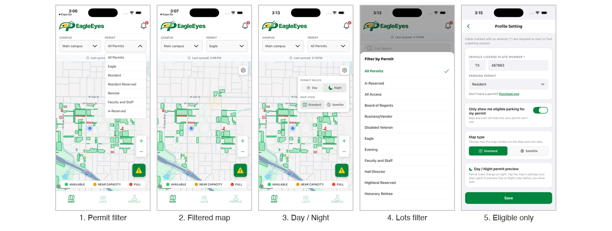

> **Disclaimer:** Restrictions can depend on the lot, the area, and the time of day. Always follow official UNT Transportation Services rules and posted signs.

#### Feature 4: Parking Lot Details
1. Open the **LOTS** tab and type a lot name in **Lot Search** (or tap a lot on the map).
2. Tap the lot to open **Lot Details**.
3. Tap **More Info** to see the address, capacity, and permits.

Details include:
- Lot name and status
- **Occupancy** (percent of the lot that is empty)
- **ParkZen capture time** (when the data was last updated)
- **Capacity**, **Address**, and accepted **Permits**
- **Get Directions** button
- **Premium Parking** button (paid lots only), which opens the payment page

#### Feature 5: Get Directions to a Lot
1. Open a lot's details (Feature 4).
2. Tap **Get Directions** and choose **Apple Maps** or **Google Maps**.

**Expected result:** the maps app opens with a route from your current location to the lot.

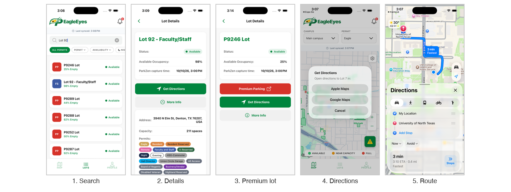

#### Feature 6: Find Nearby Parking Lots
1. Allow location access when asked, and make sure location services are on.
2. Open the **MAP** tab. The **blue dot** shows where you are (image 1 under Feature 1).
3. Check the colors of the lots around you.

> If location access is off, the blue dot is hidden and lot distances are measured from the campus center.

#### Feature 7: Note to Admin
Send a one-way message to UNT Transportation Services about a situation that doesn't fit a report category, such as a vehicle breakdown.
1. Open the report options in one of these ways:
   - Tap the green report button (yellow triangle) on the **MAP** tab.
   - Tap the same button on the **Alerts** screen.
   - Go to **PROFILE → Help & Support**.
2. Tap **Note to Admin**.
3. Fill in **Lot / Location**, **Reason**, **Start Date**, **Start Time**, **End Time** (24hr, End of day, Overnight, or Custom), **License Plate Number**, and **Phone Number**. **Detail** and **Photo** are optional.
4. Tap **Continue**, review your information, and submit.

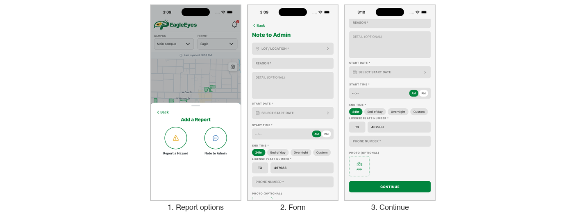

> **Disclaimer:** There is no in-app reply. A note does not guarantee your vehicle won't be moved or cited.

#### Feature 8: Report a Hazard
1. Open the report options (same entry points as Feature 7) and tap **Report a Hazard**.
2. Enter a **memo/description**.
3. Choose a **Hazard Type**: Snow, Flood, Traffic Jam, Tree Branch, or Item on Road.
4. (Optional) Tap **Select Lot** and pick a lot from the map or the nearest-first list.
5. (Optional) Add up to three photos.
6. Tap **SUBMIT**.

**Expected result:** the report goes to administrators for review. If approved, it appears in **Alerts**.

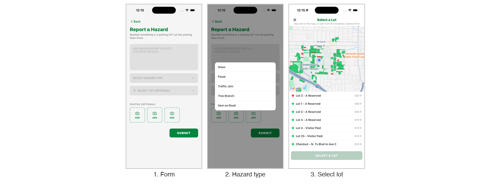

#### Feature 9: View Alerts
1. Tap the **bell icon** in the top bar. A red badge shows new alerts.
2. Filter with the **All**, **Hazard**, and **Event** tabs, and tap **EARLIER** to expand older alerts.
3. Tap an alert to see its details: type, report time, lot, who approved it, and description. Events also show when they take place.

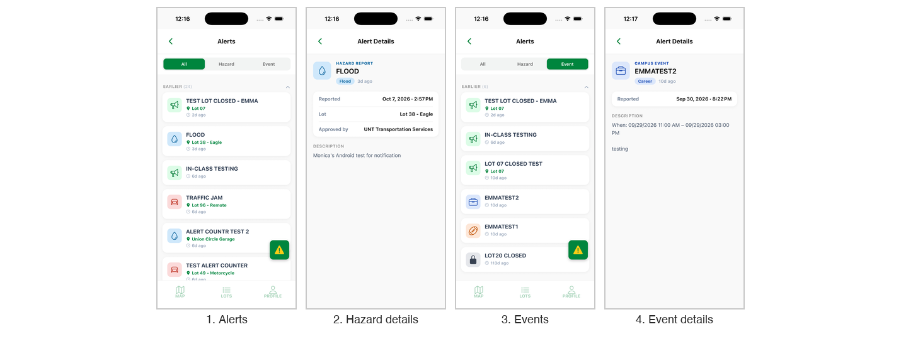

#### Feature 10: Add Your Permit
1. On the **PROFILE** tab, tap **Add Your Parking Permit** (or **Profile Setting**).
2. Enter your **Vehicle License Plate Number** (state, then plate).
3. Tap **Parking Permit** and choose your permit type. No permit yet? Tap **Purchase one**.
4. (Optional) Turn on **Only show me eligible parking for my permit**.
5. Tap **Save**.

**Expected result:** the PROFILE tab shows your permit as an active **PARKING PERMIT** card.

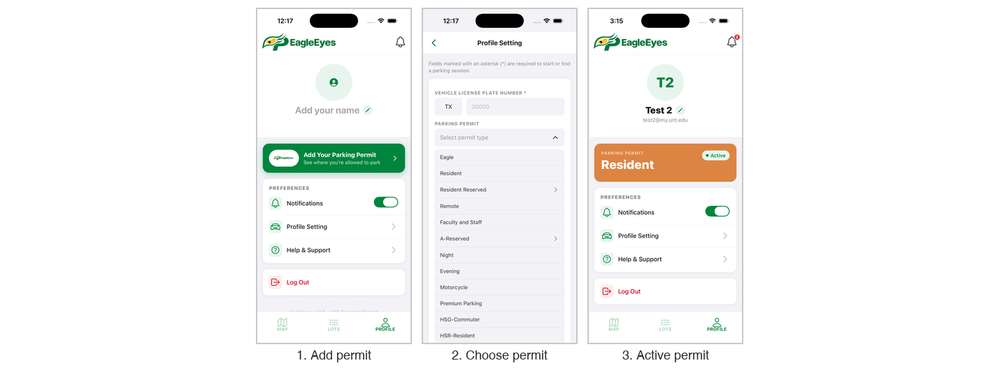

### Administrator Features
Admins log in on the same screen as commuters, with an account that has admin access. The app then shows the **HAZARDS**, **EVENTS**, and **PROFILE** tabs. The document icon in the top-right corner opens **Notes from Commuters** and shows a badge when notes are waiting.

#### Feature 11: Review Reported Hazards
1. Tap **HAZARDS**. Reports waiting for a decision are listed under **PENDING REVIEW**. Matching reports are grouped into one card, and the red badge shows how many there are.
2. Tap a card to open it.
3. Review the lot, description, reporter, and photos. You can edit the title and description, and tap **×** on a photo to remove it before publishing.
4. Tap **APPROVE** to publish the hazard to commuters' Alerts, or **DECLINE** to reject it.

> **Note:** Photos are published exactly as shown. Remove any photo that should not be public before approving.

#### Feature 12: Post a Hazard Alert
1. On **HAZARDS**, tap **+ Add Alert** (or **Post New Alert** on the PROFILE tab).
2. Enter the alert **title** (required) and a **description**.
3. Choose an **alert type** (required): Snow, Flood, Traffic Jam, Tree Branch, or Item on Road.
4. (Optional) Select a lot and add up to three photos.
5. Tap **POST**.

**Expected result:** the alert is published to commuters right away. Admin-posted alerts skip the review queue.

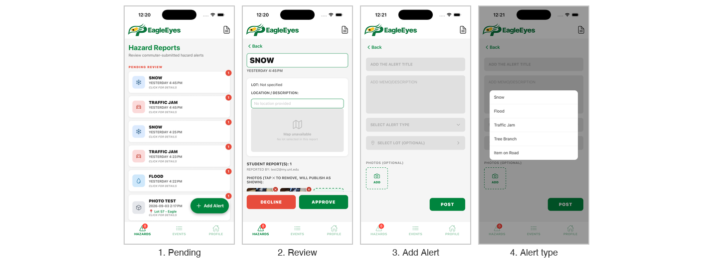

#### Feature 13: Manage Campus Events
1. Tap **EVENTS**. Dates with events are marked with a dot.
2. Tap a date to see its events, and tap an event card for its full details.
3. To create an event, tap **+ Add Event** (or **Add New Event** on the PROFILE tab) and fill in:
   - **Event Name** and **Category** (Gameday, Tailgate, Concert, Career, Closure, or Other)
   - **Affected lots** (optional)
   - **Start date/time** and **End date/time**, or check **All day** or **No end date (TBD / permanent)**
   - **Description**
4. Tap **SAVE** to publish, or **CANCEL** to discard.
5. Tap **VIEW PAST EVENTS** to review events that have ended.

**Expected result:** the event appears on the calendar and in commuters' **Alerts** under **Event**.

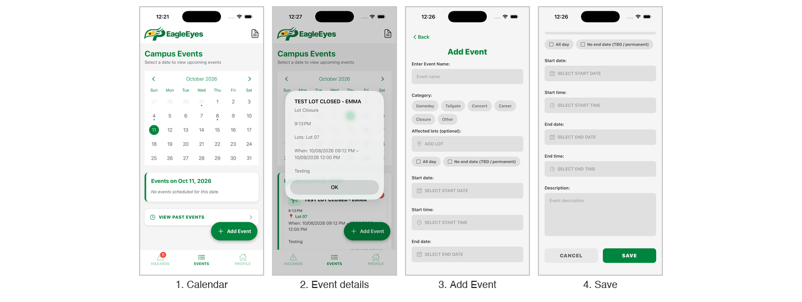

#### Feature 14: Admin Profile Shortcuts
The admin **PROFILE** tab has shortcut cards:
- **Post New Alert:** opens the Add Alert form (Feature 12).
- **Add New Event:** opens the Add Event form (Feature 13).
- **View Notes from Commuter:** read Note to Admin submissions. Tap **VIEW EXPIRED NOTES** for past notes.
- **Admin Management:** enter a commuter's email and tap **PROMOTE** to give admin access. Under **CURRENT ADMINS**, use **Make Owner** or **Revoke Access**.

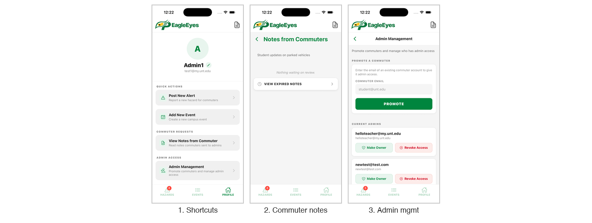

> **Note:** Admins can approve hazards, post alerts, and manage other admins. Only promote accounts you trust.

## 6. Troubleshooting

| Problem | Cause | Solution |
|---|---|---|
| Can't log in | Wrong email or password, or no account yet | Check the spelling, tap **Forgot password?**, or tap **Sign Up**. |
| No password reset email | It went to Spam, or the email was mistyped | Check Spam, then request a new code. Codes last 15 minutes. |
| No lots on the map | No internet, or the server is restarting | Reconnect, reopen the app, and wait a minute. |
| All lots are grey | ParkZen data is unavailable | Check **Last synced** and try again later. |
| My hazard report isn't in Alerts | It is waiting for admin review | No action needed. Approved reports appear automatically. |
| "Select Lot" distances seem wrong | Location access is off | Set EagleEyes location to **While Using the App** in your phone's settings. |
| iPhone app won't open, or stopped after a week | Untrusted profile, or the 7-day free install expired | Trust the profile in **VPN & Device Management**, or ask the team to reinstall. |
| Camera or photos won't open | Permission not granted | Allow **Camera** and **Photos** for EagleEyes in your phone's settings. |

## 7. Contact Information
- **Support Email:** [MonicaVu2@my.unt.edu](mailto:MonicaVu2@my.unt.edu)
- **Website:** https://eagle-eyes-park-production.up.railway.app/login
- **Repository:** https://github.com/ReyonaD/Eagle-Eye-Parking
- **In the app:** **PROFILE → Help & Support**

## 8. FAQ
**Q: Do I need an account?** Yes. Sign up with your UNT email.

**Q: How current is availability?** It reflects the latest ParkZen data. Check **Last synced** on the map or **ParkZen capture time** in a lot's details.

**Q: Why are some lots missing from the map?** A permit filter may be on. Choose **All Permits**, or turn off **Only show me eligible parking for my permit** in Profile Setting.

**Q: Can I pay for parking in the app?** For Premium Parking lots, tap the red **Premium Parking** button in the lot's details.

**Q: Will an admin reply to my note?** No. Notes are one-way, with no in-app reply.
